# Raha | راحة

**Book istirahas and chalets across Saudi Arabia, in Arabic or English.**

[](https://github.com/O5mu/raha-booking/actions/workflows/ci.yml)
[](https://raha-booking.onrender.com)

Raha is a full-stack booking platform for istirahas (private rest houses), farms and chalets. Guests search by city and dates and book, owners manage their listings and calendars, and an admin approves new listings. The whole app works in Arabic (right-to-left) and English.

The core engineering problem is the one every booking system has: **two people must never be able to book the same place for the same night**, even if they press "Book" at the same millisecond. Raha solves it inside PostgreSQL with an exclusion constraint, and an automated test fires 10 simultaneous bookings to prove only one gets through.

**Live demo: [raha-booking.onrender.com](https://raha-booking.onrender.com)**

> The demo runs on seeded sample data (22 istirahas in 7 cities and about 340 bookings). Use the **Try as guest / owner / admin** buttons on the login page, no sign-up needed. There are no real payments, and the data resets whenever the server restarts. It's on a free plan, so the first visit after a quiet period can take up to a minute while the server wakes up.

<table>
  <tr>
    <td>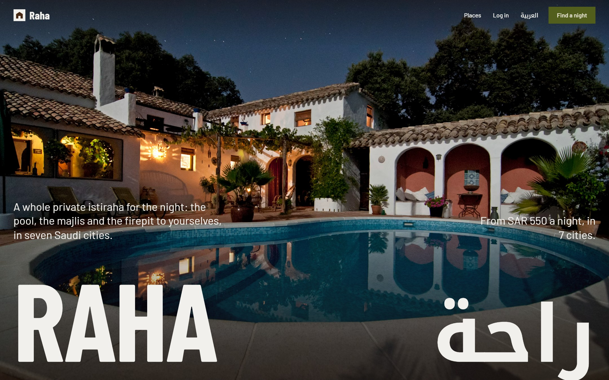</td>
    <td>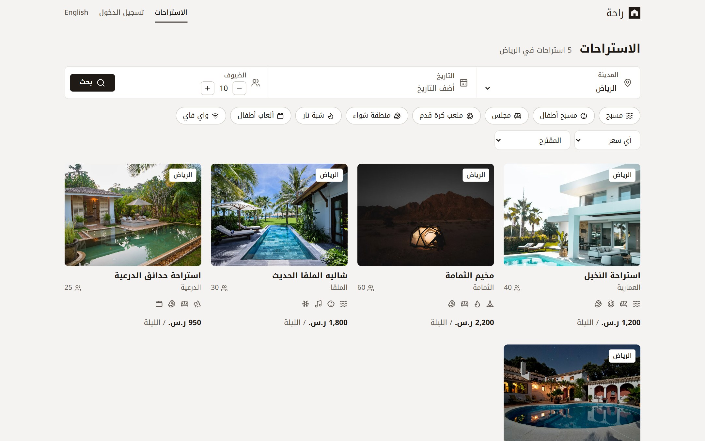</td>
  </tr>
  <tr>
    <td align="center">Home</td>
    <td align="center">Search results in Arabic (RTL)</td>
  </tr>
</table>

## Contents

- [Features](#features)
- [Preventing double bookings](#preventing-double-bookings)
- [Architecture](#architecture)
- [Tech stack](#tech-stack)
- [Design decisions](#design-decisions)
- [Run it locally](#run-it-locally)
- [Tests and CI](#tests-and-ci)
- [Project structure](#project-structure)
- [More screenshots](#more-screenshots)

## Features

**Guests**
- Search by city, dates, number of guests, maximum price and amenities (pool, majlis, firepit and more), sorted by price or recommended
- Home page with tonight's rates for every place, pulled live from the API, with booked places struck out
- Listing page with full-screen photos and an availability calendar where booked nights are crossed out
- Book with the total calculated by the server, then see a confirmation page
- My bookings: upcoming, past and cancelled, with cancellation that frees the dates for others

**Owners**
- Overview with a 14-night timeline of every istiraha, upcoming revenue and the next arrivals
- Add and edit listings in both languages, with a live preview of the search card (new listings wait for admin approval)
- Block dates for maintenance or private use, and hide or show a listing

**Admin**
- Approval queue for new listings, platform stats, all listings, users and recent bookings

**Everywhere**
- Full Arabic and English support with a one-click switch; Arabic flips the entire layout to right-to-left
- Works on phones and respects "reduce motion"
- Role-based access: guest, owner and admin, enforced on the server

## Preventing double bookings

The naive approach is to check whether the dates are free and then insert the booking. That has a race condition: two requests can both see "free" before either one inserts, and both succeed.

Raha lets the database enforce the rule instead. Every booking (and every date range an owner blocks) lives in one `bookings` table with a generated date-range column and an **exclusion constraint**:

```sql
stay DATERANGE GENERATED ALWAYS AS (daterange(check_in, check_out, '[)')) STORED,

CONSTRAINT no_double_booking
  EXCLUDE USING gist (istiraha_id WITH =, stay WITH &&)
  WHERE (status = 'confirmed')
```

In plain words: no two confirmed rows for the same istiraha (`=`) may have overlapping date ranges (`&&`). A few details matter:

- **`'[)'` (half-open range):** check-in day is included, check-out day is not, so one guest can check out on the morning the next guest checks in.
- **`WHERE status = 'confirmed'`:** cancelling a booking frees its dates automatically.
- **One table for bookings and owner blocks:** the same constraint stops a guest booking a blocked night and stops an owner blocking a booked one.
- **Concurrency:** if two transactions insert overlapping rows, one of them is rejected. The API turns that into `409 Conflict` and the page refreshes the calendar.

The booking itself runs in a transaction (`server/src/services/bookings.ts`):

1. `SELECT ... FOR UPDATE` locks the istiraha row, so bookings (and owner blocks) for the same place queue up one behind the other. This also stops the owner changing the price mid-booking.
2. The total is calculated on the server; the price the browser sends is never trusted.
3. The booking is inserted. If the dates are taken, the constraint fails with `23P01` and the API returns 409.

**A bug CI caught:** the first version locked the row with `FOR SHARE`, which lets several transactions hold the lock at once. On GitHub's runners, two overlapping inserts sometimes each waited for the other's uncommitted row, and PostgreSQL cancelled one with a deadlock error (`40P01`) instead of `23P01`. Only one booking still got through, but the loser would have seen a 500 error instead of a clear 409. Switching to `FOR UPDATE` makes the second transaction wait until the first commits, so it always fails cleanly. The API also treats `40P01` as a conflict, as a safety net.

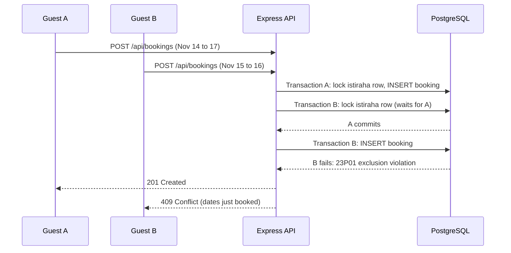

**Proof:** `server/tests/bookings.test.ts` sends 10 identical booking requests at once and asserts exactly one `201` and nine `409`s. A second test skips the API (and its lock) entirely and runs two raw SQL inserts in parallel: whichever error the loser gets, exactly one row survives, so the database holds the line even if some future code path forgets the lock. The same 10-request check was run against the live deployment with the same result.

## Architecture

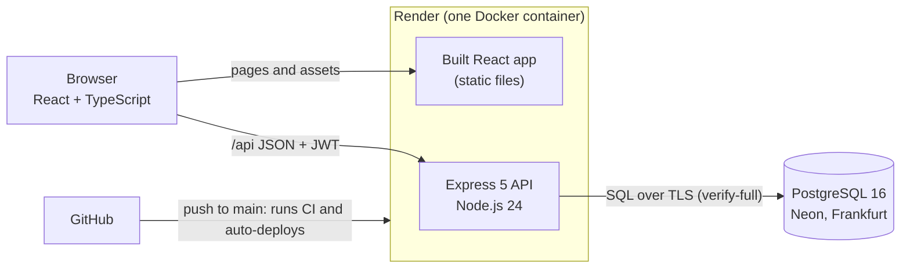

One service serves both the API and the React build, so the site has a single origin and needs no CORS. On startup the container runs pending migrations, optionally resets the demo data, then starts the API.

**Data model**

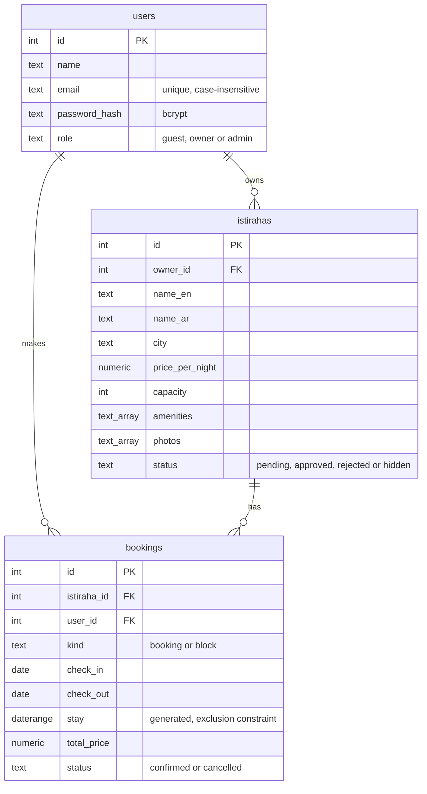

## Tech stack

| Layer | Tools |
|---|---|
| Frontend | React 19, TypeScript, Vite, React Router, TanStack Query, i18next, Motion, CSS Modules |
| Backend | Node.js 24, Express 5, TypeScript, node-postgres (raw SQL), Zod, bcrypt, JSON Web Tokens |
| Database | PostgreSQL 16 (exclusion constraint with `btree_gist`, GiST index, date ranges, arrays) |
| Testing | Vitest, Supertest, React Testing Library |
| DevOps | Docker (multi-stage build), docker compose, GitHub Actions, Render, Neon |

## Design decisions

| Decision | Why |
|---|---|
| Raw SQL with `pg` instead of an ORM | The key feature is a PostgreSQL exclusion constraint, which ORMs don't model. Writing the SQL keeps every transaction and lock visible. |
| Constraint in the database, not a check in code | A check-then-insert in application code has a race condition. The database applies the rule atomically, for every code path. |
| Row lock (`FOR UPDATE`) before inserting a booking | Concurrent inserts checked by an exclusion constraint can deadlock. Queuing bookings per istiraha keeps the error a clean 409; the constraint stays the real guarantee. |
| Dates kept as `YYYY-MM-DD` strings | Converting `DATE` columns to JavaScript `Date` objects shifts them by the server's timezone, which can move a booking by a day. |
| Prices computed on the server | Anything the browser sends can be changed in DevTools. |
| Same error for wrong email and wrong password, plus a dummy bcrypt check | Prevents attackers from discovering which emails are registered (including through response timing). |
| Ownership checks in every owner query (`WHERE owner_id = ...`) and 404 for others' listings | Owners can only touch their own data, and the API doesn't reveal that other listings exist. |
| CSS logical properties (`margin-inline-start`, `inset-inline-end`) | The same stylesheet mirrors itself for Arabic, with no separate RTL CSS. |
| Custom availability calendar | It follows the backend's half-open rule: you can check out on a day someone else checks in, but you can't select a range that jumps over another booking. |
| Gregorian calendar and Western digits for Arabic dates | `ar-SA` defaults to the Hijri calendar in `Intl`; booking apps in Saudi Arabia usually show Gregorian dates. |
| JWT stored in `localStorage` | Simple for a demo. In production I would move it to an `httpOnly` cookie with CSRF protection to reduce the impact of XSS. |
| Owner and admin dashboards lazy-loaded | Guests never download dashboard code, which keeps the first load smaller. |
| Migrations as numbered SQL files with a small runner | Each file runs once inside a transaction and is recorded in `schema_migrations`, so the database history lives in Git. |
| Multi-stage Docker image, running as a non-root user | The final image has only production dependencies and compiled code (no TypeScript, Vite or test tools). |
| Two surfaces: dark "page" screens for guests, light "app" screens for work | Browsing a place should feel like the place (big photos, a condensed display face, tobacco and olive colours). Managing bookings needs calm, dense screens: a stone ground, white panels, near-black buttons and one data colour. Both share one typeface and one set of CSS tokens, switched by a `data-surface` attribute. |
| Tonight's rates on the home page come from the live API | The home page shows the real availability for a chosen night, with booked places struck out, so the double-booking work is visible before anyone logs in. |
| A nights timeline on the owner overview | An owner's question is "which nights are still free?". One row per istiraha and one column per night answers it at a glance; owner blocks are hatched so they never read as bookings. A phone draws one week instead of two. |
| Motion only where it explains something | Sections rise in once as they scroll into view, timeline bars grow from their check-in night, and tabs slide their underline. Everything respects `prefers-reduced-motion`. |
| Tests run against a real PostgreSQL in CI | The double-booking guarantee depends on PostgreSQL itself, so it can't be mocked. |

## Run it locally

You need [Docker Desktop](https://www.docker.com/products/docker-desktop/) for the database. Node.js 24 is only needed for the development setup.

**Everything in Docker (closest to production):**

```bash
docker compose up --build
```

Then open http://localhost:8080 and use the demo buttons on the login page.

**Development setup (hot reload):**

```bash
# 1. Database
docker compose up -d db

# 2. API on http://localhost:4000
cd server
cp .env.example .env
npm install
npm run migrate
npm run seed
npm run dev

# 3. Web app on http://localhost:5173 (in a second terminal)
cd client
npm install
npm run dev
```

Demo accounts (password `demo1234`): `guest@raha.demo`, `owner@raha.demo`, `admin@raha.demo`.

## Tests and CI

```bash
cd server && npm test   # 33 API tests against the raha_test database
cd client && npm test   # 13 web app tests
```

- **API:** auth (hashing, roles, validation, no account enumeration), search filters, booking rules, the 10-concurrent-bookings test, owner and admin permissions. The test database is rebuilt from the migrations before every run, and the setup refuses to wipe any database whose name doesn't contain `test`.
- **Web app:** the availability calendar logic (with a frozen "today"), login redirects including open-redirect protection, every English key having an Arabic translation, RTL switching and Arabic plural forms.
- **GitHub Actions** runs on every push: API typecheck and tests on a PostgreSQL 16 service container, web app typecheck, tests and build, then a Docker image build.

## Project structure

```
raha-booking/
├── client/                 React app (Vite)
│   └── src/
│       ├── api/            fetch wrapper and response types
│       ├── auth/           auth context (JWT, demo login)
│       ├── components/     calendar, gallery, search bar, header, dialogs
│       ├── i18n/           en.json, ar.json and RTL switching
│       ├── lib/            date math and Intl formatting
│       └── pages/          guest pages, owner/ and admin/ dashboards
├── server/                 Express API
│   ├── db/migrations/      numbered SQL migrations
│   ├── scripts/            migrate, seed, production start
│   ├── src/
│   │   ├── middleware/     auth (JWT, roles) and error handling
│   │   ├── routes/         auth, istirahas, bookings, owner, admin
│   │   └── services/       booking transaction
│   └── tests/              Vitest + Supertest
├── db-init/                creates the test database in Docker
├── Dockerfile              multi-stage production image
├── docker-compose.yml      PostgreSQL + app
└── .github/workflows/      CI
```

## More screenshots

<table>
  <tr>
    <td colspan="2">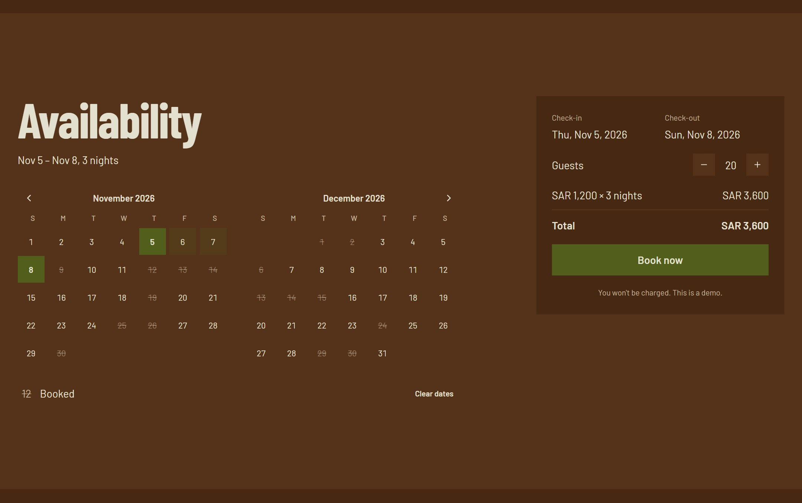</td>
  </tr>
  <tr>
    <td colspan="2" align="center">Availability calendar: booked nights are struck out, and a stay can end on the morning the next guest arrives</td>
  </tr>
  <tr>
    <td colspan="2">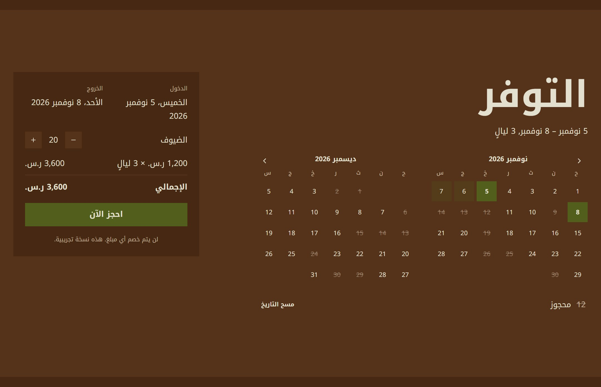</td>
  </tr>
  <tr>
    <td colspan="2" align="center">The same screen in Arabic: the layout and the calendar mirror automatically</td>
  </tr>
  <tr>
    <td>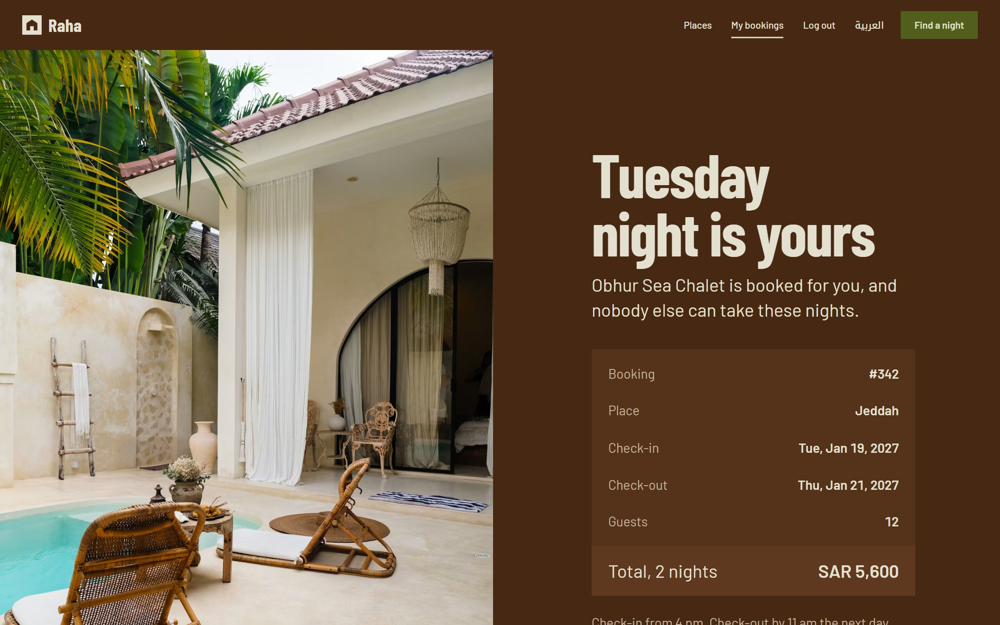</td>
    <td>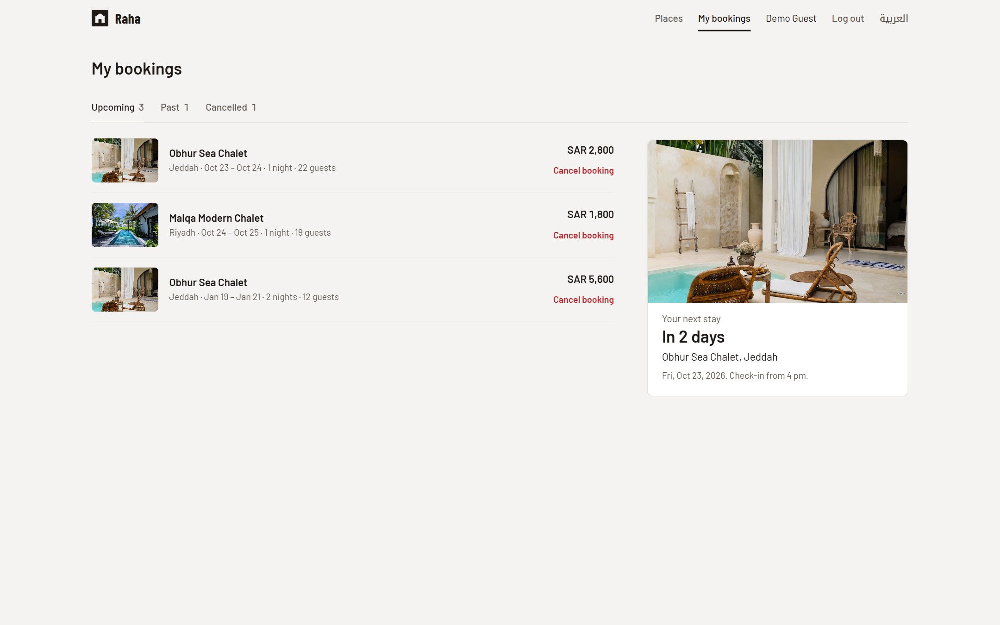</td>
  </tr>
  <tr>
    <td align="center">Booking confirmed</td>
    <td align="center">My bookings</td>
  </tr>
  <tr>
    <td>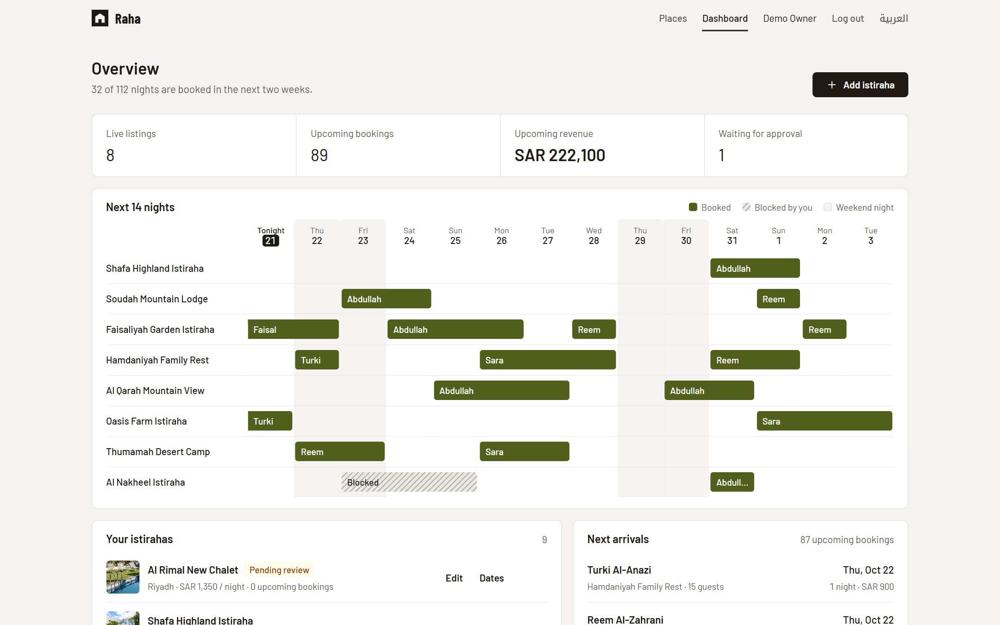</td>
    <td>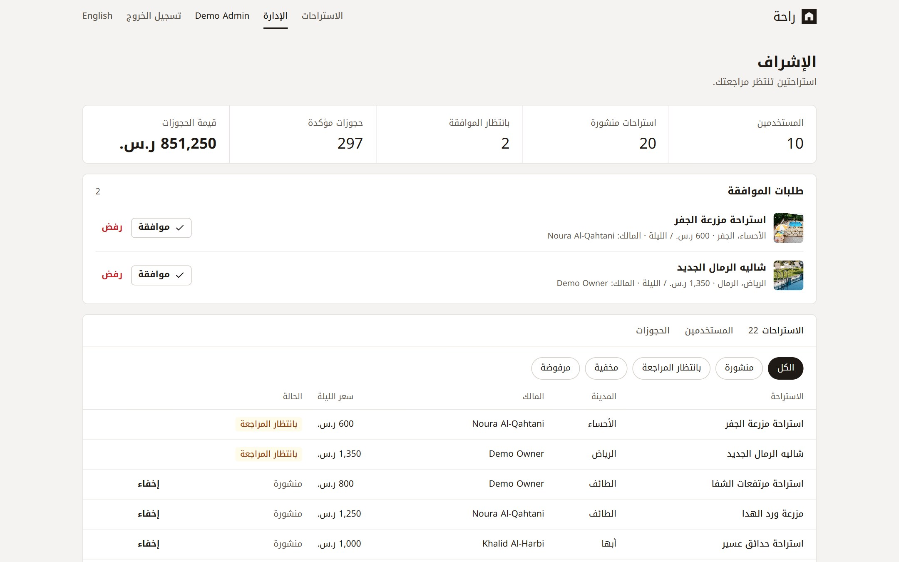</td>
  </tr>
  <tr>
    <td align="center">Owner overview: the next 14 nights of every istiraha</td>
    <td align="center">Admin moderation (Arabic)</td>
  </tr>
  <tr>
    <td>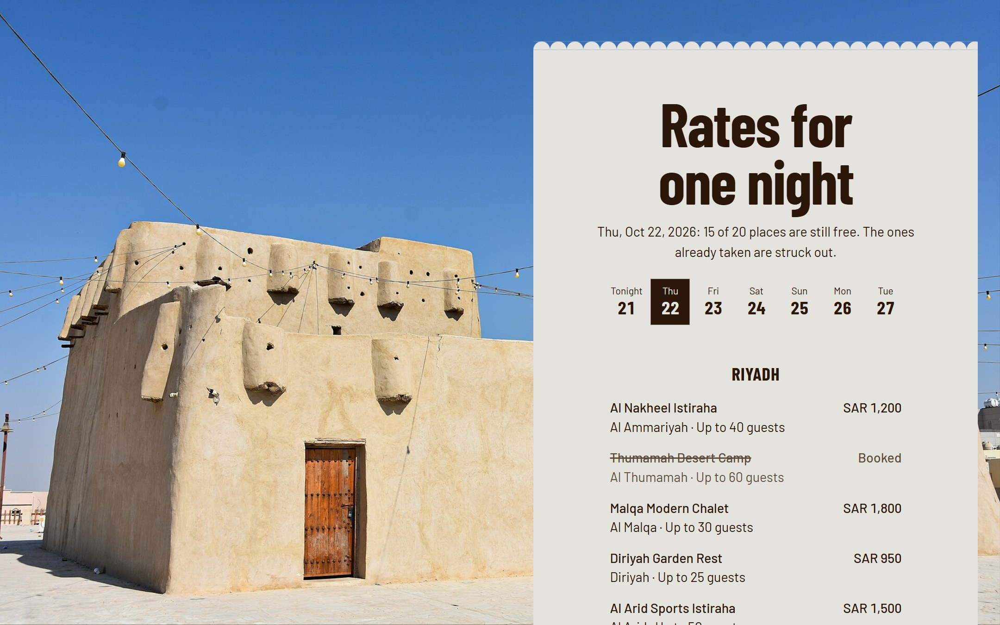</td>
    <td>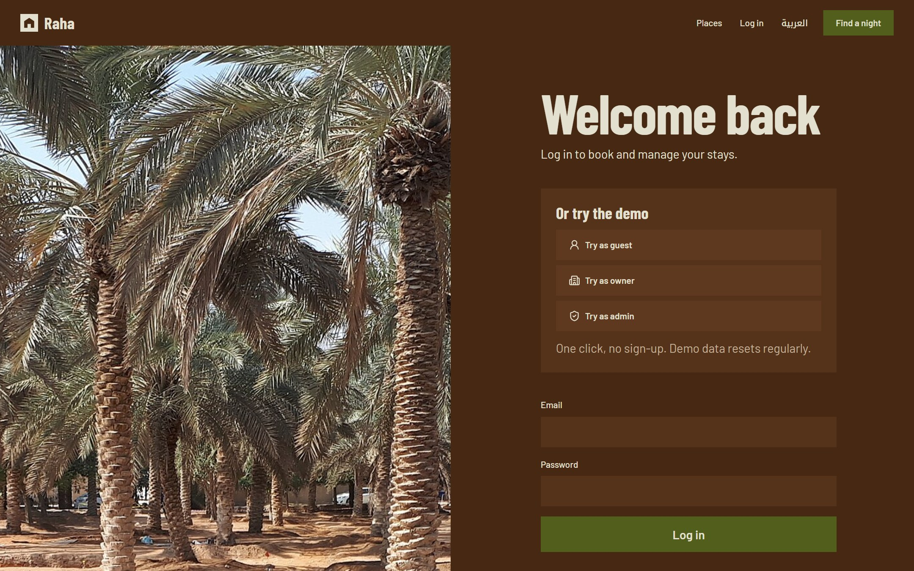</td>
  </tr>
  <tr>
    <td align="center">Tonight's rates, live from the API: booked places are struck out</td>
    <td align="center">Login with one-click demo accounts</td>
  </tr>
</table>

<p align="center">
  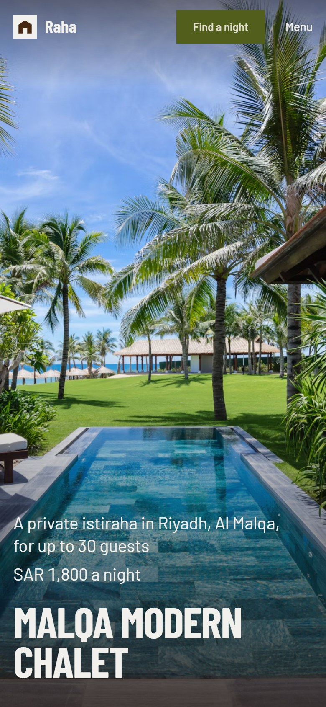
  &nbsp;&nbsp;
  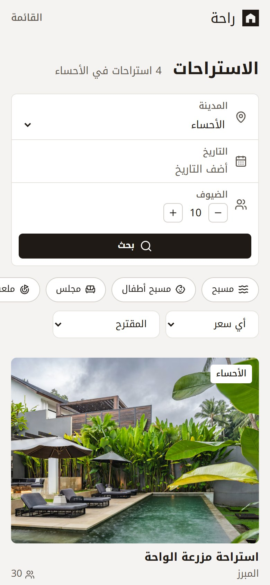
  &nbsp;&nbsp;
  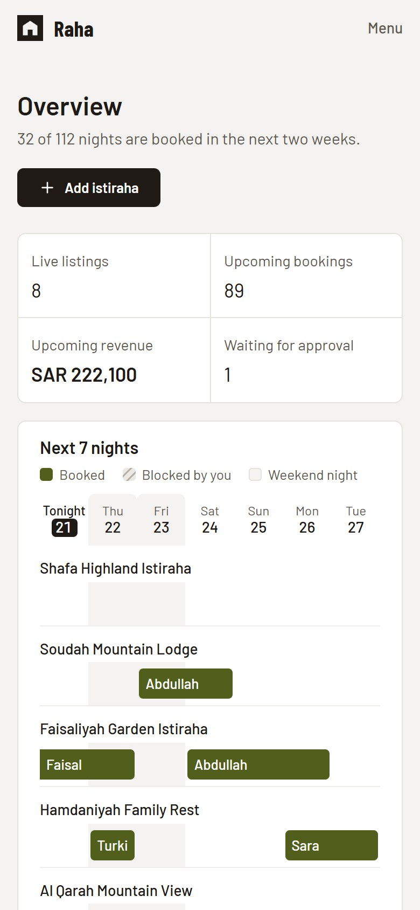
</p>

## Credits

Listing photos are from [Unsplash](https://unsplash.com) and used under the [Unsplash License](https://unsplash.com/license). The page photos come from Wikimedia Commons: Mihayris Fort by Richard Mortel (CC BY 2.0), the palms of Diriyah by Matti&Keti (CC0), the dallah by Bluehillies (CC0) and the fire by Mostafameraji (CC0). All listings, owners, guests and bookings are fictional.

## Author

**Osama Al-Bassam**, Software Engineering graduate, KFUPM
[GitHub](https://github.com/O5mu) · [Portfolio](https://o5mu.github.io/osama-portfolio/)
